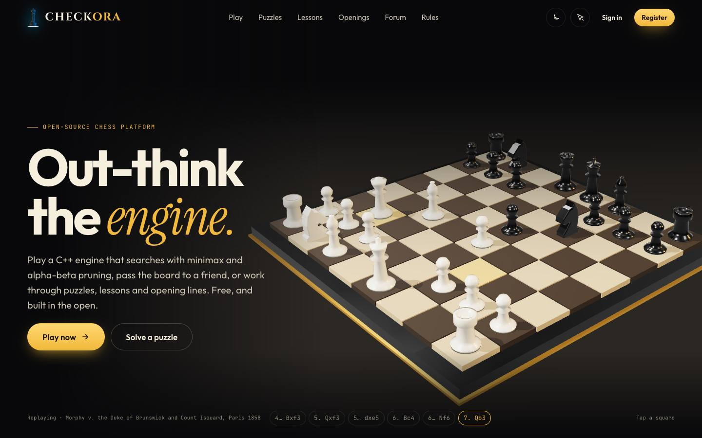
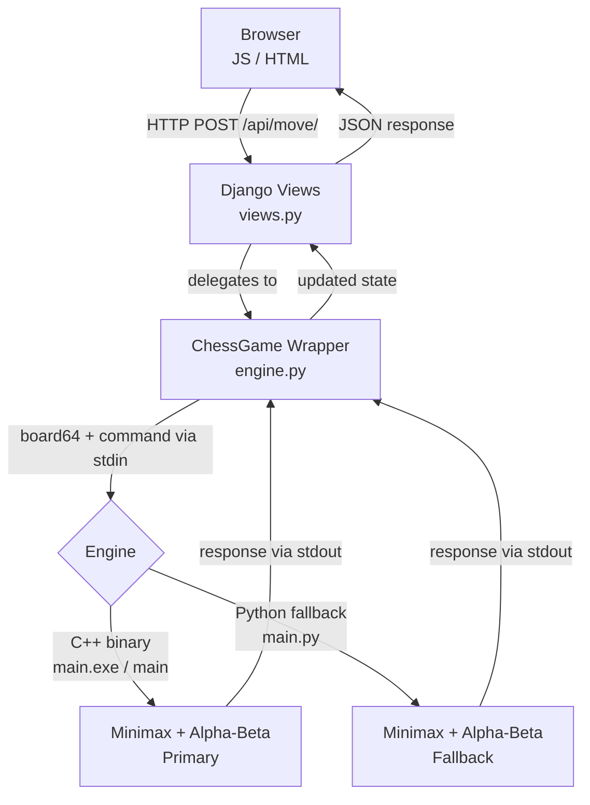

<div align="center">

# Checkora

**An open-source chess platform with an AI opponent powered by minimax search with alpha-beta pruning.**

Built on Django with a high-performance C++ engine and a Python fallback for maximum compatibility.

[](https://www.python.org/)
[](https://www.djangoproject.com/)
[](https://isocpp.org/)
[](LICENSE)
[](https://github.com/Checkora/Checkora/actions/workflows/ci.yml)
[](https://github.com/Checkora/Checkora/issues)
[](CONTRIBUTING.md)
[](https://discord.gg/DvW3xVXw8g)



Join our Discord community for updates, support, and games: https://discord.gg/DvW3xVXw8g

### Core Maintainers

<table>
       <tr>
              <td align="center" style="padding: 6px 18px;">
                     <a href="https://github.com/EDWARD-012">
                            
                     </a>
                     <br />
                     <a href="https://github.com/EDWARD-012"><strong>@EDWARD-012</strong></a>
                     <br />
                     <a href="https://github.com/EDWARD-012">
                            
                     </a>
              </td>
              <td align="center" style="padding: 6px 18px;">
                     <a href="https://github.com/triemerge">
                            
                     </a>
                     <br />
                     <a href="https://github.com/triemerge"><strong>@triemerge</strong></a>
                     <br />
                     <a href="https://github.com/triemerge">
                            
                     </a>
              </td>
       </tr>
</table>

<sub>Click a profile or follow badge for release drops, roadmap notes, and engine updates.</sub>

</div>

---

## Contributors

<!-- CONTRIBUTORS_START -->
<a href="https://github.com/0rbiT-ai"></a><a href="https://github.com/2005rishabh"></a><a href="https://github.com/ANISHA-RAWAT"></a><a href="https://github.com/AdityaM-IITH"></a><a href="https://github.com/Ashvin-KS"></a><a href="https://github.com/BistNaveenSingh"></a><a href="https://github.com/CodeMaster11000"></a><a href="https://github.com/DebasmitaBose0"></a><a href="https://github.com/DeepeshKafalatiya"></a><a href="https://github.com/EDWARD-012"></a><a href="https://github.com/EnKruptos"></a><a href="https://github.com/FTS18"></a><a href="https://github.com/Gurkaran18"></a><a href="https://github.com/Harsh2865"></a><a href="https://github.com/HarshMrigank"></a><a href="https://github.com/Khushi-Verse"></a><a href="https://github.com/Kinara2020"></a><a href="https://github.com/KrishKyada"></a><a href="https://github.com/Lakshayg136"></a><a href="https://github.com/MahalaxmiKannan"></a><a href="https://github.com/Manthan29-code"></a><a href="https://github.com/Mouni-Sanaboyina"></a><a href="https://github.com/Nakshathra-2808"></a><a href="https://github.com/NayansiDupare"></a><a href="https://github.com/Nihal-io"></a><a href="https://github.com/NiranjanRSoorej06"></a><a href="https://github.com/OmanshiRaj"></a><a href="https://github.com/PRODHOSH"></a><a href="https://github.com/Pooja-V4"></a><a href="https://github.com/Pranav-0440"></a><a href="https://github.com/Pranava116"></a><a href="https://github.com/Pum14"></a><a href="https://github.com/Rajal-ui"></a><a href="https://github.com/RuchiSheoran"></a><a href="https://github.com/RuhanikaChotwani"></a><a href="https://github.com/Sakina-786-vi"></a><a href="https://github.com/SaptadeepMondal"></a><a href="https://github.com/Sara-Thakur"></a><a href="https://github.com/SecureAditi"></a><a href="https://github.com/Shashank-8p"></a><a href="https://github.com/Shrishagk"></a><a href="https://github.com/SiRa111"></a><a href="https://github.com/Siddh2024"></a><a href="https://github.com/Siddharth-sde"></a><a href="https://github.com/SilverMenace"></a><a href="https://github.com/Soumipal56"></a><a href="https://github.com/SrashtiChauhan"></a><a href="https://github.com/Sreekuttan-007"></a><a href="https://github.com/Steel-roger-moondradev"></a><a href="https://github.com/UjsGit"></a><a href="https://github.com/VITianYash42"></a><a href="https://github.com/Vaishnav-Hub9"></a><a href="https://github.com/Xenon010101"></a><a href="https://github.com/YASHcode-IIITV"></a><a href="https://github.com/YashKrTripathi"></a><a href="https://github.com/Yashisinghal285"></a><a href="https://github.com/Yogender-verma"></a><a href="https://github.com/aayushbamal"></a><a href="https://github.com/akash3911"></a><a href="https://github.com/akashgoudsidduluri"></a><a href="https://github.com/akhilmodi29"></a><a href="https://github.com/akshatsinghai6682-sketch"></a><a href="https://github.com/amarpratapsingh2452"></a><a href="https://github.com/amm-09"></a><a href="https://github.com/aniketchauhan16"></a><a href="https://github.com/ankitasahu83964"></a><a href="https://github.com/anshiikaa001"></a><a href="https://github.com/anshul23102"></a><a href="https://github.com/anwitamishra"></a><a href="https://github.com/artiverma-00"></a><a href="https://github.com/ash1shkumar"></a><a href="https://github.com/asnaassalam"></a><a href="https://github.com/bh462007"></a><a href="https://github.com/bhatiakavisha"></a><a href="https://github.com/chekr-max"></a><a href="https://github.com/cozyneurons"></a><a href="https://github.com/debugger1711"></a><a href="https://github.com/deepsikha-dash"></a><a href="https://github.com/dhhhhruv"></a><a href="https://github.com/diptipradeep"></a><a href="https://github.com/divya-d510"></a><a href="https://github.com/enoshdev"></a><a href="https://github.com/gowthamrdyy"></a><a href="https://github.com/harsh-kr9"></a><a href="https://github.com/harshitkr13"></a><a href="https://github.com/hetbharodiya"></a><a href="https://github.com/itsdakshjain"></a><a href="https://github.com/jancysen"></a><a href="https://github.com/jayesh-durge"></a><a href="https://github.com/kartik12421"></a><a href="https://github.com/kavin553"></a><a href="https://github.com/khushi-in-tech"></a><a href="https://github.com/krishkhinchi"></a><a href="https://github.com/kush-mehra1"></a><a href="https://github.com/manish354200"></a><a href="https://github.com/manurajgoel"></a><a href="https://github.com/maria-453"></a><a href="https://github.com/mikotomisakaa2"></a><a href="https://github.com/mishtiagrawal02-cloud"></a><a href="https://github.com/mittalsonal"></a><a href="https://github.com/nayana888ks"></a><a href="https://github.com/nipundeept"></a><a href="https://github.com/nishtha-agarwal-211"></a><a href="https://github.com/niy-ati"></a><a href="https://github.com/niyatijoshi707"></a><a href="https://github.com/nkc-gh"></a><a href="https://github.com/parthc6416"></a><a href="https://github.com/parthpatidar03"></a><a href="https://github.com/pratyuxxhh"></a><a href="https://github.com/radhikaa188"></a><a href="https://github.com/rajat552"></a><a href="https://github.com/rajatsurana19"></a><a href="https://github.com/renganathc"></a><a href="https://github.com/richachauhan15"></a><a href="https://github.com/rmagdaleena2508-01"></a><a href="https://github.com/roneet0916"></a><a href="https://github.com/saswatdutta1310"></a><a href="https://github.com/shauryaparth1902-blip"></a><a href="https://github.com/shreyamahesh07-git"></a><a href="https://github.com/shrutip04"></a><a href="https://github.com/shrutisharma-sh"></a><a href="https://github.com/shubhamjrd4559-sudo"></a><a href="https://github.com/som996"></a><a href="https://github.com/somu0571"></a><a href="https://github.com/soniya28gupta"></a><a href="https://github.com/sreevyarao"></a><a href="https://github.com/sricharan-213"></a><a href="https://github.com/ssuyashhhh"></a><a href="https://github.com/sujithputta02"></a><a href="https://github.com/sureshsuriya"></a><a href="https://github.com/tazmeen24"></a><a href="https://github.com/tharunika-19"></a><a href="https://github.com/the404packet"></a><a href="https://github.com/triemerge"></a><a href="https://github.com/unnati-jaiswal24"></a><a href="https://github.com/vikrantkulkarni07"></a><a href="https://github.com/vishwassinfinity"></a><a href="https://github.com/yuvraj-k-singh"></a><a href="https://github.com/zqleslie"></a>
<!-- CONTRIBUTORS_END -->

## Features

| Feature              | Description                                                                                         |
| -------------------- | --------------------------------------------------------------------------------------------------- |
| AI Opponent          | Minimax search with alpha-beta pruning, at four levels from easy to master                          |
| Hybrid Engine        | C++ binary for maximum speed with an automatic Python fallback                                      |
| Full Move Validation | Legal moves enforced for all pieces including castling, en passant, and promotion |
| Game Timer           | Per-player countdown clocks with pause support                                                      |
| Material Score Panel | Live material advantage tracking that updates dynamically during gameplay                           |
| REST API             | Clean JSON endpoints powering a decoupled frontend                                                  |
| PvP & PvE Modes      | Play against a friend or challenge the AI                                                           |
| Accounts             | Email sign-up or "Continue with Google", a settings page, and a profile picture (a piece or an upload) |
| Rating and progress  | An Elo rating against the engine level played, ranks from Pawn to King, points, levels and streaks |

---

## Documentation
- [Feature Guide](./FEATURES.md)
- [API reference](./docs/API.md)
- [Engine architecture](./docs/engine_architecture.md)
- [Local development](./docs/development.md) and [testing](./docs/testing.md)
- [Design system](./docs/design-system.md), for anyone adding or changing a page
- [Frontend JavaScript guide](./docs/frontend-guide.md)

---

## Quick Start

```bash
# 1. Clone the repository
git clone https://github.com/Checkora/Checkora.git
cd Checkora

# 2. Set up a virtual environment
python -m venv venv
venv\Scripts\activate        # Windows
source venv/bin/activate     # macOS / Linux

# Note: Django 6.0 requires Python 3.12 or higher. If you have multiple
# versions on Windows, use a compatible installed version, e.g.:
# py -3.12 -m venv venv

# 3. Install dependencies
pip install -r requirements.txt

# 4. Set up environment variables
# Copy example env file
# Windows (PowerShell)
copy .env.example .env

# macOS / Linux
cp .env.example .env

# Open `.env` and set SECRET_KEY if needed
# Keep the DEBUG=True line that .env.example ships with: DEBUG is off unless .env turns it on
# Configure EMAIL_HOST_USER and EMAIL_HOST_PASSWORD for OTP and password reset emails
# Optional: GOOGLE_CLIENT_ID and GOOGLE_CLIENT_SECRET turn on "Continue with Google" (see .env.example)
# 5. Run migrations and start the server
python manage.py migrate
python manage.py runserver
```

Open **`http://127.0.0.1:8000/`** in your browser. This is the landing page; the board is at `/play/`. The terminal shows this same address — always use **`http://`**, never **`https://`**, because the development server does not support SSL.

### Compile the C++ Engine _(optional but recommended)_

The compiled binary is not committed to the repository. Each contributor compiles for their own platform. If the binary is absent, Checkora automatically falls back to the Python engine.

```bash
# Windows
g++ -O2 -std=c++17 game/engine/main.cpp -o game/engine/main.exe

# macOS / Linux
g++ -O2 -std=c++17 game/engine/main.cpp -o game/engine/main
```

Run the same command again after every pull that changes `game/engine/main.cpp`. A binary built from older sources is detected (it does not answer the protocol version the bridge asks for), and the Python engine plays until the binary is rebuilt.

## Project Structure

Checkora follows a modular project structure to separate the frontend, backend, engine logic, and documentation clearly.

The tree below shows the main directories and files with a line on each. It does not list every file:

```text
Checkora/
├── .github/                       # GitHub configurations
│   ├── ISSUE_TEMPLATE/            # Issue blueprints for contributors
│   │   ├── bug_report.md          # Form for reporting software bugs
│   │   └── feature_request.md     # Form for proposing feature improvements
│   ├── workflows/                 # CI/CD automation pipelines
│   │   ├── ci.yml                 # Main test and lint automation workflow
│   │   ├── contributors.yml       # Automatically maintains the contributor catalog in README
│   │   └── label-gssoc.yml        # Automatically labels issues for GSSoC contributors
│   └── PULL_REQUEST_TEMPLATE.md   # PR template establishing code quality requirements
├── api/                           # Serverless API configurations
│   └── wsgi.py                    # Vercel-specific WSGI application configuration
├── core/                          # Django project core configuration
│   ├── __init__.py                # Package initialization marker
│   ├── asgi.py                    # Entry point for ASGI-compatible web servers
│   ├── settings.py                # Global settings (DB config, middleware, security headers)
│   ├── urls.py                    # Root URL router mapping to views
│   └── wsgi.py                    # Entry point for WSGI-compatible web servers
├── docs/                          # Detailed architecture guides
│   ├── images/                    # Images used by the README, FEATURES.md and structure.md
│   ├── API.md                     # Raw technical spec for REST API endpoints
│   ├── SECURITY_HEADERS_AUDIT.md  # Deep security analysis and policy audit reports
│   ├── design-system.md           # Base template, CSS tokens and components for building pages
│   ├── development.md             # Local setup and everyday commands
│   ├── engine_architecture.md     # Detailed minimax and communication workflow analysis
│   ├── frontend-guide.md          # What each JavaScript module does
│   └── testing.md                 # Where the tests are and how to run them
├── game/                          # Core Chess application module
│   ├── engine/                    # The AI Chess engine directory
│   │   ├── main.cpp               # High-performance C++17 Minimax + Alpha-Beta pruning engine
│   │   ├── main.py                # Pure Python 3.12 fallback replica of the C++ engine
│   │   ├── opening_book.json      # Structured dictionary mapping classic opening moves
│   │   └── persistent_server.py   # Keeps one engine process running per game
│   ├── migrations/                # Database schema version histories
│   │   ├── 0001_initial.py        # Relational schema for GameResult and Profiles
│   │   ├── 0002_add_missing...   # Database schema patch adding draw reason records
│   │   ├── 0003_alter_game...     # Migration establishing foreign key user associations
│   │   ├── 0004_gameresult...     # Migration adding active game player color records
│   │   ├── ...                    # Later migrations, in order
│   │   ├── 0044_rated_games...    # Adds GameResult.rated, PuzzleStats.last_daily_date and the PuzzleSolve table
│   │   ├── 0045_seed_achiev...    # Creates the Achievement rows that game/services.py unlocks
│   │   ├── 0046_fix_seed_pu...    # Replaces the seven built-in daily puzzles with valid mates in one
│   │   ├── 0047_google_account.py # Adds the GoogleAccount table
│   │   ├── 0048_profiles_rat...   # Picture preset, upload time, time zone and rename date on UserProfile, best day streak, RatingHistory.game_result
│   │   └── __init__.py            # Package initialization marker
│   ├── selenium_tests/            # UI browser integration tests
│   │   ├── __init__.py            # Package initialization marker
│   │   ├── base.py                # Setup, teardown, and WebDriver helpers for integration runs
│   │   ├── test_boards.py         # Automated UI click-and-drag gameplay flow tests
│   │   └── test_navigation.py     # Automated browser routing and navigation validation tests
│   ├── static/                    # Frontend client-side resources
│   │   └── game/                  # Main namespace directory
│   │       ├── css/               # Modular stylesheet templates
│   │       │   ├── app.css        # Design system: tokens, both themes, shared components, toasts
│   │       │   ├── account.css    # Sign-in, registration, password reset, profile, picture, settings and account deletion pages
│   │       │   ├── community.css  # Forum, leaderboard, achievements, stats and match history
│   │       │   ├── cursor.css     # Custom cursor styles
│   │       │   ├── error.css      # 404 and 500 pages
│   │       │   ├── landing.css    # Landing page
│   │       │   ├── learn.css      # Lessons, puzzles, opening trainer and rules pages
│   │       │   └── play.css       # Play page: setup, the board, both side panels and the dialogs
│   │       ├── js/                # Client-side dynamic scripts
│   │       │   ├── app.js         # Shared behaviour loaded on every page: navbar, menus, dialogs, reveals
│   │       │   ├── auth.js        # Validates dynamic auth form submissions
│   │       │   ├── board.js       # Chess grid events, capture drawers, API calls, clock tickers
│   │       │   ├── perf.js        # Chooses the performance tier (high or low) before the first paint
│   │       │   ├── play_view.js   # Board theme, 3D view and setup screen of the play page
│   │       │   ├── scene3d.js     # three.js scenes: the landing page board and the turning piece
│   │       │   ├── toast.js       # Manages toast alert popups and life-cycles
│   │       │   └── ...            # The other modules are listed in docs/frontend-guide.md
│   │       ├── board/             # Wood textures of the board: maple.webp, walnut.webp, frame.webp
│   │       ├── pieces/            # Piece pictures: staunton/ and staunton-single/ (WebP, the default), and the SVG sets classic/, wood/ and outline/
│   │       ├── vendor/three/      # Vendored three.js build used by scene3d.js
│   │       ├── sounds/            # Gameplay sound effects
│   │       │   ├── capture.mp3    # Capture sound alert
│   │       │   ├── check.wav      # Check sound warning
│   │       │   ├── draw.mp3       # Game draw chime
│   │       │   ├── move.wav       # Chess piece move tick
│   │       │   └── ...            # draw_end.mp3, loss.mp3, timeout.mp3 and win.mp3
│   │       ├── checkora_icon_only.png # Project brand mark
│   │       └── favicon.jpeg       # Small browser favicon
│   ├── templates/                 # Server-side HTML render blueprints
│   │   ├── 404.html               # Custom 404 error page template
│   │   ├── 500.html               # Custom 500 error page template (standalone, does not extend base.html)
│   │   ├── robots.txt             # Web crawler configuration instructions
│   │   ├── sitemap.xml            # SEO indexing guide
│   │   └── game/                  # Namespace folder matching Django conventions
│   │       ├── includes/          # Reusable UI partial layout blocks
│   │       │   ├── avatar.html    # A player's picture or initial, drawn by the  tag
│   │       │   ├── footer.html    # Site footer
│   │       │   ├── google_button.html # "Continue with Google", shown only when a Google client is set up
│   │       │   ├── legal.html     # Privacy policy, terms and disclaimer dialogs opened from the footer
│   │       │   ├── logo.html      # Checkora logo and wordmark, linking to the landing page
│   │       │   ├── messages.html  # Banner rendering Django alert notifications
│   │       │   ├── navbar.html    # Site navigation, theme toggle and account menu
│   │       │   ├── privacy_text.html # Privacy policy text, used by /privacy/ and the footer dialog
│   │       │   ├── rank_badge.html   # Rank badge, drawn by the  tag
│   │       │   └── terms_text.html   # Terms text, used by /terms/ and the footer dialog
│   │       ├── account.html       # Account settings at /account/
│   │       ├── avatar.html        # Picture picker: preset pieces or an upload
│   │       ├── base.html          # Base template the pages extend (see docs/design-system.md)
│   │       ├── board.html         # Interactive gameplay chessboard and player cards
│   │       ├── confirm_delete_account.html # Confirmation page opened by the emailed account deletion link
│   │       ├── google_username.html # A new Google player picks a username here
│   │       ├── landing.html       # Landing page served at /
│   │       ├── leaderboard.html   # Rating and puzzle leaderboards
│   │       ├── login.html         # Sign-in form interface
│   │       ├── privacy.html       # Privacy policy page at /privacy/
│   │       ├── profile.html       # Rating, rank, level and streaks of the signed-in player
│   │       ├── register.html      # Create account interface
│   │       ├── terms.html         # Terms page at /terms/
│   │       ├── verify_email_change.html # Code entry for a new email address
│   │       ├── verify_otp.html    # Two-factor verification panel
│   │       ├── rules.html         # Gameplay and chess educational rules guide
│   │       ├── stats.html         # User match metrics, profiles, and scoreboards
│   │       ├── welcome_email.html # HTML email template sent to users after successful registration
│   │       ├── password_reset.html # Password reset trigger page
│   │       ├── password_reset_complete.html # Confirmation of successful reset
│   │       ├── password_reset_confirm.html  # Verification form link target
│   │       ├── password_reset_done.html     # Outlines password email delivery status
│   │       ├── password_reset_email.html    # HTML layout for reset emails
│   │       └── password_reset_subject.txt   # Email subject text file
│   ├── templatetags/
│   │   └── players.py             #  and 
│   ├── __init__.py                # Package initialization marker
│   ├── accounts.py                # Account rules: usernames, emails, Google signups, renames
│   ├── apps.py                    # Django configuration class definition
│   ├── avatars.py                 # Preset piece pictures, and uploads re-encoded for /u/<id>/avatar/
│   ├── context_processors.py      # Tells templates whether Google sign-in is set up
│   ├── engine.py                  # ChessGame: the game's state, the engine commands and their replies
│   ├── engine_client.py           # Finds, starts and talks to the engine server of each game
│   ├── forms.py                   # Forms for registration, account settings, pictures and the forum
│   ├── google_auth.py             # The Google side of "Continue with Google" (OpenID Connect with PKCE)
│   ├── icon.jpeg                  # Main project thumbnail graphic
│   ├── middleware.py              # Security headers, and the player's time zone from the tz cookie
│   ├── models.py                  # Database schemas mapping matches and profiles
│   ├── progression.py             # Rating, rank, points, levels and streaks
│   ├── services.py                # Standalone functions managing core business logic
│   ├── tests.py                   # The largest Django test module
│   ├── test_*.py                  # Further test modules, such as test_accounts.py and test_engine_rules.py
│   ├── urls.py                    # Application level router mapping endpoints
│   ├── views.py                   # Django controller layer dispatching API and HTML requests
│   ├── views_account.py           # Profile, picture, account settings and account deletion
│   └── views_google.py            # Google sign-in, linking, and the username step for new players
├── scripts/
│   ├── engine_match.py            # Plays two engine builds or levels against each other and reports the Elo difference
│   ├── render_pieces.mjs          # Renders the Staunton piece pictures
│   └── render_wood.mjs            # Draws the wood textures of the board
├── .env.example                   # Baseline local configuration variables blueprint
├── .gitignore                     # Configures Git to ignore builds, caches, and database logs
├── CODE_OF_CONDUCT.md             # Contributor environment code of conduct guidelines
├── CONTRIBUTING.md                # Guide detailing branch formats and pull request rules
├── LICENSE                        # Open-source MIT license deed
├── README.md                      # Primary project overview
├── board.test.js                  # Jest tests for board.js
├── forum.test.js                  # Jest tests for forum.js
├── requirements.txt               # Required Python packages
├── requirements-dev.txt           # requirements.txt plus test-only packages (python-chess)
├── manage.py                      # Django CLI control center script
├── package.json                   # Jest dependencies and the `npm test` script
├── package-lock.json              # Locked frontend dependency version tree
├── structure.md                   # Extended architectural blueprint documentation
└── vercel.json                    # Configuration for serverless Django routing on Vercel
```

## Architecture

Checkora uses a clean three-layer architecture:

```
Browser (JS/HTML/CSS)
       |
       v
Django Views (views.py)          <- HTTP request handling & session state
       |
       v
ChessGame Wrapper (engine.py)    <- Translates board state into engine commands
       |
       v
Engine client (engine_client.py) <- One engine server per game (persistent_server.py)
       |
       |---> C++ Binary (main.exe / main)   <- Primary: fast minimax AI
       +---> Python Script (main.py)        <- Fallback: identical logic in Python
```

| Layer             | Technology            | Path                              |
| ----------------- | --------------------- | --------------------------------- |
| Frontend          | HTML, CSS, JavaScript | `game/templates/game/board.html`  |
| Backend           | Django 6.x            | `game/views.py`, `game/engine.py`, `game/engine_client.py` |
| Engine (Primary)  | C++17                 | `game/engine/main.cpp`            |
| Engine (Fallback) | Python 3.12+          | `game/engine/main.py`             |

> For a full deep-dive into the backend components, execution flow, and AI internals, see the [Architecture Guide](structure.md).

### How It Works

When a player makes a move, the request flows through three layers:

1. **Browser** sends a `POST` request with the move coordinates
2. **Django** (`views.py`) receives it and delegates to the `ChessGame` wrapper in `engine.py`
3. **`engine.py`** serializes the board into a flat 64-character string and builds the command line. `game/engine_client.py` hands it to the game's engine server, `game/engine/persistent_server.py`, which keeps one engine process running per game and talks to it over `stdin` and `stdout`. A one-off engine process answers when that server is not available

The engine speaks a simple text-based protocol:

| Command    | Example                                          | Response                                    |
| ---------- | ------------------------------------------------ | ------------------------------------------- |
| `VERSION`  | `VERSION`                                        | `VERSION 2`                                 |
| `MOVES`    | `MOVES <board64> <rights> <turn> <epRow> <epCol> row col` | `MOVES tr tc is_capture is_promotion ...`   |
| `ATTACKED` | `ATTACKED <board64> <rights> <attackerColor> row col` | `YES` / `NO`                                |
| `PROMOTE`  | `PROMOTE <board64> <rights> <turn> <epRow> <epCol> fr fc tr tc [piece]` | `PROMOTE <newBoard64>` / `INVALID <reason>` |
| `STATUS`   | `STATUS <board64> <rights> <turn> <epRow> <epCol>` | `STATUS CHECK / CHECKMATE / STALEMATE / DRAW / OK` |
| `NOTATION` | `NOTATION <board64> <rights> <turn> <epRow> <epCol> fr fc tr tc [piece]` | `NOTATION <san>` / `NOTATION ?` for an illegal move |
| `EVAL`     | `EVAL <board64> <rights> <turn> <epRow> <epCol>` | `EVAL <centipawns>`                         |
| `PERFT`    | `PERFT <board64> <rights> <turn> <epRow> <epCol> <depth>` | `PERFT <leaf nodes>`                        |
| `BESTMOVE` | `BESTMOVE <board64> <rights> <turn> <epRow> <epCol> <depth> [timeLimitMs [halfmoveClock [alternatives [earlier positions...]]]]` | `BESTMOVE fr fc tr tc EVAL <cp> ...` / `BESTMOVE NONE` |

This is version 2 of the protocol. Every command gets exactly one reply line, and a line that cannot be parsed is answered with `ERROR <reason>`. The header comments of `game/engine/main.cpp` and `game/engine/main.py` define it, and [docs/engine_architecture.md](docs/engine_architecture.md) explains each command, the search and the difficulty levels.



---

## API Reference

Checkora features a decoupled API layer. Below is the endpoint catalog accompanied by explicit request and response structures to assist frontend integrations.

> [!NOTE]
> All state-modifying requests (`POST`) require a CSRF token passed via the `X-CSRFToken` HTTP header, except for `/api/cron/cleanup-stale-games/`, which is CSRF-exempt and checks a bearer token instead.

| Method | Endpoint | Description | Request Example |
| :--- | :--- | :--- | :--- |
| `GET` | `/` | Render the landing page (`/home/` redirects here) | *N/A (Standard HTML Page)* |
| `GET` | `/play/` | Render the board UI | *N/A (Standard HTML Page)* |
| `GET` | `/api/state/` | Retrieve full game state from session | `/api/state/` |
| `POST` | `/api/move/` | Execute a move on the board | `/api/move/` |
| `GET` | `/api/valid-moves/` | Get all legal moves for a selected piece | `/api/valid-moves/?row=6&col=4` |
| `POST` | `/api/new-game/` | Start a new PvP or PvE game | `/api/new-game/` |
| `GET` | `/api/check-promotion/` | Check if a pawn reaches the promotion rank | `/api/check-promotion/?from_row=1&from_col=0&to_row=0` |
| `POST` | `/api/ai-move/` | Request the engine to compute the best move | `/api/ai-move/` |
| `POST` | `/api/pause/` | Pause/Resume game timer countdown | `/api/pause/` |
| `POST` | `/api/timeout/` | End the game on time once the server's clock has run out | `/api/timeout/` |
| `POST` | `/api/resume/` | Resume a previously saved game | `/api/resume/` |
| `POST` | `/api/resign/` | Resign the current game | `/api/resign/` |
| `POST` | `/api/draw/` | Offer or accept a draw in PvP mode | `/api/draw/` |
| `GET` | `/api/check-username/` | Check if a username is available | `/api/check-username/?username=player1` |
| `POST` | `/api/analyze-game/` | Analyze a completed game and return statistics (login required) | `/api/analyze-game/` |
| `POST` | `/api/opening-stats/` | Save the result of an opening trainer run (login required) | `/api/opening-stats/` |
| `GET` | `/api/puzzle-stats/` | Retrieve puzzle streak and statistics | `/api/puzzle-stats/` |
| `POST` | `/api/puzzles/<id>/solve/` | Check a puzzle solution and count the solve (login required) | `/api/puzzles/12/solve/` |
| `GET`, `POST` | `/api/cron/cleanup-stale-games/` | Secure cron-triggered cleanup for abandoned games | `/api/cron/cleanup-stale-games/` |

The full reference, with every field and error response, is in [docs/API.md](docs/API.md). It also covers sign-in with a password or with Google, the account settings forms and the profile picture endpoints.

---

### Request/Response JSON Examples

#### 1. Retrieve Game State (`GET /api/state/`)
Called on board load to restore ongoing match positions and clocks.

**Response (Success - `200 OK`):**

```json
{
  "board": [
    ["r", "n", "b", "q", "k", "b", "n", "r"],
    ["p", "p", "p", "p", "p", "p", "p", "p"],
    [null, null, null, null, null, null, null, null],
    [null, null, null, null, null, null, null, null],
    [null, null, null, null, null, null, null, null],
    [null, null, null, null, null, null, null, null],
    ["P", "P", "P", "P", "P", "P", "P", "P"],
    ["R", "N", "B", "Q", "K", "B", "N", "R"]
  ],
  "version": 0,
  "current_turn": "white",
  "white_time": 600,
  "black_time": 600,
  "time_limit": 600,
  "increment": 0,
  "paused": true,
  "move_history": [],
  "captured_pieces": {"white": [], "black": []},
  "mode": "pvp",
  "player_color": "white",
  "difficulty": "medium",
  "white_name": "White",
  "black_name": "Black",
  "fen": "rnbqkbnr/pppppppp/8/8/8/8/PPPPPPPP/RNBQKBNR w KQkq - 0 1",
  "pgn": "[Event \"Checkora Match\"]",
  "game_status": "active",
  "in_check": false,
  "draw_reason": null,
  "threefold_warning": false,
  "opening_name": null,
  "opening_moves": null,
  "rated": false
}
```

*Note: `in_check` is true while the side to move is in check; `game_status` stays "active" during a check. `rated` is true only for a logged-in user playing the AI from the standard starting position. If a clock has run out, this request ends the game: `game_status` is "timeout" and a `winner` field is added. Logged-in users also get `day_streak`.*

#### 2. Execute a Move (`POST /api/move/`)
Triggered when a player releases a piece onto a destination square.

**Request Body:**

*Note: `promotion_piece` is optional ("q", "r", "b", "n") and required only if `check-promotion` is true.*

```json
{
  "from_row": 6,
  "from_col": 4,
  "to_row": 4,
  "to_col": 4,
  "promotion_piece": "q"
}
```

**Response (Success - `200 OK`):**

*Note: `board` is an 8x8 array reflecting the updated state. `message` is the move in algebraic notation. `game_status` can be "ok", "check", "checkmate", "stalemate", "draw", or "timeout".*

```json
{
  "valid": true,
  "message": "e4",
  "captured": null,
  "board": [],
  "current_turn": "black",
  "white_time": 595,
  "black_time": 600,
  "time_limit": 600,
  "increment": 0,
  "move_history": [
    {"notation": "e4", "piece": "P", "from": [6, 4], "to": [4, 4], "captured": null, "color": "white", "promoted_to": null}
  ],
  "opening_name": "King's Pawn Game",
  "opening_moves": "e4",
  "captured_pieces": {"white": [], "black": []},
  "game_status": "ok",
  "draw_reason": null,
  "threefold_warning": false,
  "fen": "rnbqkbnr/pppppppp/8/8/4P3/8/PPPP1PPP/RNBQKBNR b KQkq e3 0 1",
  "pgn": "[Event \"Checkora Match\"]",
  "white_name": "White",
  "black_name": "Black",
  "version": 0
}
```

**Response (rejected move - `200 OK` with `valid` false):**

*Note: the body is the same object as above with the position unchanged; only the fields that differ are shown.*

```json
{
  "valid": false,
  "message": "Illegal move.",
  "game_status": "active"
}
```

**Response (Error):** `400 Bad Request` with `{"error": "Invalid board coordinates"}` for missing or out-of-range coordinates, `403 Forbidden` when it is the computer's turn in an AI game, and `409 Conflict` when a logged-in user's game changed in the meantime.

#### 3. Get Valid Moves (`GET /api/valid-moves/`)
Instructs the frontend UI where the selected piece can legally go.

**Request Parameters:** `?row=6&col=4`

**Response (Success - `200 OK`):**

```json
{
  "valid_moves": [
    {"row": 4, "col": 4, "is_capture": false, "is_promotion": false},
    {"row": 5, "col": 4, "is_capture": false, "is_promotion": false}
  ]
}
```

#### 4. Request AI Move (`POST /api/ai-move/`)
Triggers background minimax engine search. Returns the move calculated by the C++/Python engine.

**Response (Success - `200 OK`):**

*Note: `board` is an 8x8 array reflecting the updated state. `move_history` contains the list of moves. `message` and `game_status` work as in `/api/move/`.*

```json
{
  "valid": true,
  "message": "d5",
  "captured": null,
  "board": [],
  "current_turn": "white",
  "white_time": 600,
  "black_time": 598,
  "time_limit": 600,
  "increment": 0,
  "move_history": [],
  "opening_name": "Queen's Pawn Game",
  "opening_moves": "d4 d5",
  "captured_pieces": {"white": [], "black": []},
  "ai_move": {
    "from_row": 1,
    "from_col": 3,
    "to_row": 3,
    "to_col": 3
  },
  "game_status": "ok",
  "draw_reason": null,
  "threefold_warning": false,
  "fen": "rnbqkbnr/ppp1pppp/8/3p4/3P4/8/PPP1PPPP/RNBQKBNR w KQkq d6 0 2",
  "pgn": "[Event \"Checkora Match\"]",
  "white_name": "White",
  "black_name": "Black",
  "opening": "",
  "version": 0
}
```

**Response (Error):** `400 Bad Request` when there is no AI game, the game is over or paused, or it is the player's turn; `429 Too Many Requests` when the rate limit is reached; `503 Service Unavailable` when the engine returns no move for a position that is not finished.

#### 5. Start New Game (`POST /api/new-game/`)
Resets current session variables and starts a fresh match.

**Request Body:**

*Note: `mode` can be "pvp" or "ai".*

```json
{
  "mode": "ai"
}
```

**Response (Success - `200 OK`):**

*Note: `board` is an 8x8 array containing the clean initial board configuration. `forfeited` is true when a logged-in user's rated game in progress was ended and recorded to make way for this one.*

```json
{
  "valid": true,
  "board": [],
  "current_turn": "white",
  "move_history": [],
  "captured_pieces": {"white": [], "black": []},
  "mode": "ai",
  "player_color": "white",
  "white_name": "White",
  "black_name": "♗ Tactical Bishop",
  "difficulty": "medium",
  "time_limit": 600,
  "increment": 0,
  "fen": "rnbqkbnr/pppppppp/8/8/8/8/PPPPPPPP/RNBQKBNR w KQkq - 0 1",
  "pgn": "[Event \"Checkora Match\"]",
  "game_status": "active",
  "in_check": false,
  "draw_reason": null,
  "opening": "",
  "version": 0,
  "rated": false,
  "forfeited": false
}
```

#### 6. Analyze Game (`POST /api/analyze-game/`)
Analyzes a completed game based on its move history and returns statistics. The user must be logged in; an anonymous request gets `401 Unauthorized`.

**Request Body:**

```json
{
  "moves": ["e4", "e5", "Nf3", "Nc6"],
  "result": "White wins",
  "reason": "checkmate"
}
```

**Response (Success - `200 OK`):**

*Note: `move_analysis_details` has one entry per analysed half-move, and `move_analysis` lists their classes ("Best", "Inaccuracy", "Mistake", "Blunder" or "Unknown").*

```json
{
  "result": "White wins",
  "end_reason": "checkmate",
  "opening": "King's Pawn Game",
  "captures": 0,
  "checks": 0,
  "checkmates": 0,
  "promotions": 0,
  "blunders": 0,
  "mistakes": 0,
  "accuracy": 100,
  "total_moves": 2,
  "move_analysis_details": [
    {"move_num": 1, "color": "White", "played": "e4", "best": "Nf3", "class": "Unknown", "eval": null},
    {"move_num": 1, "color": "Black", "played": "e5", "best": "d5", "class": "Unknown", "eval": null},
    {"move_num": 2, "color": "White", "played": "Nf3", "best": "Nc3", "class": "Unknown", "eval": null},
    {"move_num": 2, "color": "Black", "played": "Nc6", "best": "Nc6", "class": "Best", "eval": null}
  ],
  "move_analysis": ["Unknown", "Unknown", "Unknown", "Best"],
  "analysis_timeout_seconds": 10,
  "truncated": false,
  "final_eval": null
}
```

#### 7. Get Puzzle Stats (`GET /api/puzzle-stats/`)
Returns puzzle streak information for the puzzle interface. A logged-in user gets their own numbers; an anonymous request gets zeros.

**Response (Success - `200 OK`):**

```json
{
  "streak": 0,
  "longest_streak": 0,
  "puzzles_solved": 0,
  "daily_completions": 0
}
```

#### 8. Cleanup Cron (`GET` or `POST /api/cron/cleanup-stale-games/`)
Secure cron-triggered cleanup endpoint for abandoned games. `vercel.json` schedules it once a day.

**Request Headers:**

```http
Authorization: Bearer <cron_secret>
```

**Response (Success - `200 OK`):**

```json
{
  "status": "success",
  "deleted_games": 2,
  "resigned_games": 1,
  "purged_records": 0,
  "purged_sessions": 0
}
```

#### 9. Claim timeout (`POST /api/timeout/`)
Called by the board when its clock reaches zero. The server ends the game only if its own stored clock has run out as well.

**Response (Success - `200 OK`):**

```json
{
  "valid": true,
  "game_status": "timeout",
  "winner": "black",
  "white_time": 0,
  "black_time": 412,
  "version": 0
}
```

**Response (clock still running - `400 Bad Request`):**

```json
{
  "valid": false,
  "message": "Clock has not run out.",
  "white_time": 3,
  "black_time": 412
}
```

#### 10. Solve puzzle (`POST /api/puzzles/<id>/solve/`)
Checks the moves played against the puzzle's stored solution and counts the solve for the logged-in user. `counted` is `false` when the user opened that puzzle's solution in the last seven days; the answer is still checked, but nothing is counted.

**Request Body:**

```json
{
  "moves": ["g2g4"]
}
```

**Response (Success - `200 OK`):**

```json
{
  "success": true,
  "correct": true,
  "counted": true,
  "newly_solved": true,
  "puzzles_solved": 1,
  "streak": 1,
  "longest_streak": 1,
  "daily_completions": 1
}
```

---

## Tests

The test suite runs fully in-memory — no compiled engine binary required.

```bash
pip install -r requirements-dev.txt
python manage.py test game
```

The Django tests are in `game/tests.py` and the `game/test_*.py` modules. They cover the API endpoints, move validation, both engines and the bridge to them, the difficulty levels, accounts and Google sign-in, and ratings, points and streaks. `requirements-dev.txt` adds python-chess. Some engine tests check both engines against it, and they are skipped when it is missing. The command also collects the Selenium tests in `game/selenium_tests/`, which need Chrome. [docs/testing.md](docs/testing.md) has the details.

The JavaScript tests run on Jest:

```bash
npm ci
npm test
```

That runs the 103 tests in `board.test.js` and `forum.test.js`.

---

## Troubleshooting Guide

Below are solutions to common setup, installation, and environment issues contributors encounter when getting Checkora running locally.

### 🐍 1. Python Version Mismatch
Django 6.x is built on modern Python paradigms and strictly requires **Python 3.12 or higher**. If you run an older version, dependencies in `requirements.txt` will fail to resolve or throw syntax errors during server boot.

*   **Check version:**
    ```bash
    python --version
    ```
*   **Resolution (Windows multiple installations):**
    Use the Python Launcher to explicitly target 3.12+ when creating your virtual environment:
    ```bash
    py -3.12 -m venv venv
    ```
*   **Resolution (macOS/Linux):**
    Ensure `python3` points to a 3.12+ installation (e.g., via Homebrew: `brew install python@3.12`).

### 📦 2. Virtual Environment Activation Issues
Depending on your terminal shell or system policies, activating the virtual environment might throw permission or script execution errors.

*   **Windows PowerShell execution restriction error:**
    If you see an error like `Script execution is disabled on this system`, bypass the policy for the active process:
    ```powershell
    Set-ExecutionPolicy -Scope Process -ExecutionPolicy Bypass
    venv\Scripts\Activate.ps1
    ```
*   **Activation commands for different shells:**

    | Shell | Command |
    | :--- | :--- |
    | **Windows Cmd** | `venv\Scripts\activate.bat` |
    | **Windows PowerShell** | `venv\Scripts\Activate.ps1` |
    | **Git Bash / WSL / Linux / macOS** | `source venv/bin/activate` |
    | **Fish Shell** | `source venv/bin/activate.fish` |

### 🛠️ 3. g++ Compiler Installation & Configuration Problems
The C++ chess engine has to be compiled locally to get the faster engine. If `g++` is missing or not configured correctly, the compile command fails. 

> [!TIP]
> If `g++` setup is too tricky for your system, you can skip compiling it! Checkora will automatically detect the absence of the binary and fall back to the Python engine in `game/engine/main.py`. It does the same for a binary that is not executable or was built from older sources.

*   **Check compiler availability:**

    ```bash
    g++ --version
    ```
*   **Resolution (Windows):**
    1. Download the MinGW-w64 compiler suite (we recommend the simple, portable [w64-devkit](https://github.com/skeeto/w64-devkit)).
    2. Add the `bin` directory (containing `g++.exe`) to your system's **Environment Variables** -> **PATH** list.
    3. Restart your terminal so the new path takes effect.
*   **Resolution (macOS):**
    Install the Xcode Command Line Tools:

    ```bash
    xcode-select --install
    ```
*   **Resolution (Ubuntu/Debian Linux):**

    ```bash
    sudo apt update && sudo apt install build-essential
    ```

### 💾 4. Database Migration Errors
If migrations fail to run, or database models get out of sync, you may encounter relational database exceptions.

*   **Resolution:**
    Reset your local SQLite database structure by running:

    ```bash
    # 1. Generate any missing database schema blueprints
    python manage.py makemigrations game
    
    # 2. Safely apply schema blueprints
    python manage.py migrate
    ```
    *If conflicts persist, delete the local `db.sqlite3` file and re-run the commands above to construct a clean database.*

### 🔑 5. Missing `.env` Configuration File
If you attempt to launch the Django server without setting up a local configuration file, Django will throw `KeyError` or configuration load failures for crucial settings.

*   **Resolution:**
    Ensure you clone the template configuration into a new active `.env` file in the root directory:

    ```bash
    # Windows PowerShell
    copy .env.example .env
    
    # macOS / Linux
    cp .env.example .env
    ```
    Open `.env` and verify you have a robust string under `SECRET_KEY`.
    Keep `DEBUG=True` in it for local work. `core/settings.py` leaves
    `DEBUG` off unless `.env` turns it on. With it off you get the custom
    500 page instead of Django's traceback, and OTP and password reset
    emails go to the SMTP server instead of being printed in the terminal.
    Additionally, ensure `TRUSTED_PROXY_IPS` is configured (defaulting to
    `127.0.0.1,::1` for local development). `TRUSTED_PROXIES` remains
    supported as a legacy fallback.

    > **⚠️ Security Warning for Production:**
    > When deploying behind reverse proxies (Vercel, Cloudflare, AWS ALB,
    > etc.), you must set `TRUSTED_PROXY_IPS` to your platform's upstream
    > proxy IPs. Incorrect configuration allows attackers to spoof their
    > IP address and bypass rate limiting entirely.

### 🔌 6. Port Conflicts (Port 8000 Already in Use)
If you already have another service running on your local port 8000, Django will fail to bind and throw `Error: That port is already in use.`

*   **Resolution:**
    Instruct Django to boot the local server on an alternative unoccupied port, for example, `8080` or `8001`:

    ```bash
    python manage.py runserver 8080
    ```

### 🔒 7. Local SSL Error (`ERR_SSL_PROTOCOL_ERROR`)

If the browser shows `ERR_SSL_PROTOCOL_ERROR` or the terminal prints *"You're accessing the development server over HTTPS, but it only supports HTTP"*, the browser is using HTTPS against the local HTTP dev server.

*   **Resolution:**
    1. Copy the example env file if you have not already: `copy .env.example .env` (Windows) or `cp .env.example .env` (macOS/Linux).
    2. Copy the exact URL from the terminal, for example **`http://127.0.0.1:8000/`** — include `http://` and do not let the browser change it to `https://`.
    3. Disable your browser's HTTPS-upgrade setting for local development (for example, Chrome/Brave: "Always use secure connections" / "Upgrade connections to HTTPS").
    4. Clear cached HSTS for `127.0.0.1` if the browser keeps forcing HTTPS (Chrome/Brave: `chrome://net-internals/#hsts`; steps vary by browser).

## Contributor Support & Feedback

We want your contribution journey with Checkora to be smooth, welcoming, and productive! If you hit roadblocks or have ideas, please utilize the following channels:

### 💬 1. Join our Discord Community
Our central hub for live discussions, playtesting matches, roadmap announcements, and direct maintainer support.
- **Invite Link:** [Join the Checkora Discord Server](https://discord.gg/DvW3xVXw8g)
- **Active Channels:**
  - `#setup-help`: For environment, dependencies, or local compilation challenges.
  - `#engine-chat`: For deep-dives into minimax heuristics, board representation, and alpha-beta pruning.
  - `#suggestions`: For sharing your design mocks, UI improvements, or gameplay feature proposals.

### ❓ 2. Ask Setup & Installation Questions
If you prefer forum-style threading over live Discord chat:
- Open a question on our [GitHub Discussions page](https://github.com/Checkora/Checkora/discussions) under the **Q&A / Help** category.
- Search prior threads; many common setups or dependencies are documented by fellow contributors.

### 📚 3. Report Documentation Confusion
If a section of this guide, `structure.md`, or `API.md` is unclear, out of date, or missing steps:
- File a [GitHub Issue](https://github.com/Checkora/Checkora/issues/new) and attach the `documentation` label. The repository has issue templates for bug reports and feature requests only.
- *Better yet:* Submit a quick pull request correcting the text! We love docs-focused contributions.

### 💡 4. Share Feature Proposals & Suggestions
Want to introduce a new gameplay timer format, customize themes, or build a matching lobby?
- Share your proposals in [GitHub Discussions Ideas](https://github.com/Checkora/Checkora/discussions/categories/ideas).
- Align with core maintainers (@EDWARD-012 & @triemerge) before writing significant logic to ensure architectural compatibility.

## Contributing

Contributions are welcome! Please read [CONTRIBUTING.md](CONTRIBUTING.md) for branch naming conventions, commit message format, and PR guidelines before submitting.

---

## License

Released under the [MIT License](LICENSE).
