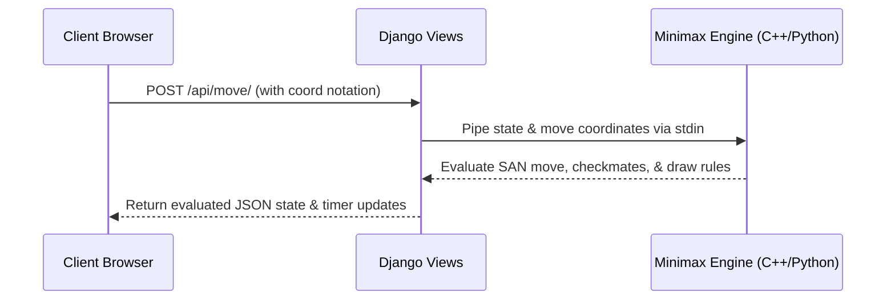

# Checkora REST API Developer Walkthrough

This document provides developers with a step-by-step walkthrough of the Checkora REST API. It outlines the core endpoints, payload structures, session state restoration, and offline diagnostics utilities.

---

## 🗺️ API Architecture & Flow Overview

Checkora leverages a **hybrid chess architecture**:
1. The **Frontend (Vanilla Javascript + HTML/CSS)** sends user moves to the Django REST endpoints.
2. The **Django Backend** routes the moves to the **C++ Chess Engine** process (or its pure-Python fallback script) via standard input/output streams.
3. The calculated move evaluations and game status flags are returned in JSON format to the client, synchronizing the interactive UI.



---

## 🛠️ Offline Developer Diagnostics

Before integrating with the API, developers can inspect their local environments, virtual environments, compiled engines, and opening books by running:

```bash
python manage.py validate_env
```

This diagnostic utility returns instantaneous status indicators for:
- The `SECRET_KEY` setting (warns when it is shorter than 32 characters)
- Whether a `g++` compiler is on the PATH
- Path checks and execution permissions for the compiled chess engine binary (`game/engine/main.exe` or `game/engine/main`), and the presence of the Python fallback `game/engine/main.py`
- The database connection and any unapplied migrations
- The presence of the `game/static/` directory

---

## 🔗 Key REST Endpoints & Play Scenarios

The responses below are shortened to the fields the walkthrough talks about. [API.md](API.md) lists every field and error response.

### 1. Initializing a Match (`POST /api/new-game/`)
Resets the player's active session state and sets up a clean board.

- **Payload Structure** (`time_limit` is in seconds, and `difficulty` is `easy`, `medium`, `hard` or `master`):
  ```json
  {
    "mode": "ai",
    "player_color": "white",
    "difficulty": "medium",
    "time_limit": 600
  }
  ```
- **Response Mapping**:
  ```json
  {
    "board": [
      ["r", "n", "b", "q", "k", "b", "n", "r"],
      ["p", "p", "p", "p", "p", "p", "p", "p"],
      [null, null, null, null, null, null, null, null]
    ],
    "current_turn": "white",
    "move_history": [],
    "captured_pieces": {"white": [], "black": []},
    "mode": "ai"
  }
  ```

### 2. Dispatching a Move (`POST /api/move/`)
Sends a move to the backend to validate and execute.

- **Payload Structure**:
  ```json
  {
    "from_row": 6,
    "from_col": 4,
    "to_row": 4,
    "to_col": 4,
    "promotion_piece": null
  }
  ```
- **Response Mapping**:
  ```json
  {
    "valid": true,
    "board": [ ... ],
    "current_turn": "black",
    "captured": null,
    "game_status": "ok",
    "move_history": [
      {
        "notation": "e4",
        "from": [6, 4],
        "to": [4, 4],
        "piece": "P",
        "color": "white"
      }
    ]
  }
  ```
  After an ordinary move `game_status` is `"ok"`. The other values are `"check"`, `"checkmate"`, `"stalemate"`, `"draw"` and `"timeout"`.

### 3. Polling AI Countermoves (`POST /api/ai-move/`)
Triggered automatically by the frontend after a player's move completes in `Play vs AI` mode.

- **Response Mapping**:
  ```json
  {
    "valid": true,
    "board": [ ... ],
    "current_turn": "white",
    "ai_move": {
      "from_row": 1,
      "from_col": 4,
      "to_row": 3,
      "to_col": 4
    },
    "move_history": [
      {
        "notation": "e4", "from": [6, 4], "to": [4, 4], "piece": "P", "color": "white"
      },
      {
        "notation": "e5", "from": [1, 4], "to": [3, 4], "piece": "p", "color": "black"
      }
    ],
    "game_status": "ok"
  }
  ```

### 4. Running out of time (`POST /api/timeout/`)
When the clock on the page reaches zero, the frontend asks the server to end the game. The server checks its own stored clock. If that has run out too, the game is recorded as a loss on time and the response names the winner. If not, the server answers `400` with its clock values and the page carries on from those.

- **Response Mapping**:
  ```json
  {
    "valid": true,
    "game_status": "timeout",
    "winner": "black"
  }
  ```

---

## 🔒 Security Requirements & Headers

Except for `/api/cron/cleanup-stale-games/` (which is CSRF-exempt and checks a bearer token instead), **every state-modifying POST request must provide the Django CSRF validation token**. That includes `/api/pause/`.

### Extracting CSRF via Javascript
```javascript
const csrfToken = document.querySelector('[name=csrfmiddlewaretoken]').value;

const response = await fetch('/api/move/', {
    method: 'POST',
    headers: {
        'Content-Type': 'application/json',
        'X-CSRFToken': csrfToken
    },
    body: JSON.stringify(moveData)
});
```

---

## 🧩 Troubleshooting API Integration Problems

1. **403 Forbidden Error on POSTs**:
   - *Cause*: Missing `X-CSRFToken` in request headers.
   - *Fix*: Read the token from the hidden `csrfmiddlewaretoken` input and bind it to the fetch headers map. The CSRF cookie is `HttpOnly` (`CSRF_COOKIE_HTTPONLY = True` in `core/settings.py`), so a script cannot read it from `document.cookie`.
2. **Moves are slow, or the AI answers with `503`**:
   - *Cause*: The engine did not answer. The bridge waits up to 10 seconds for a reply. A compiled binary that is not executable or was built from older sources is not used at all; the Python engine plays instead, and it is slower. A slow reply on its own is not a fault on the higher levels: `hard` thinks for up to 5 seconds a move and `master` for up to 8.5, less when the clock is low.
   - *Fix*: Run `python manage.py validate_env` to verify executable permissions, and rebuild the binary with `g++ -O2 -std=c++17 game/engine/main.cpp -o game/engine/main`.
