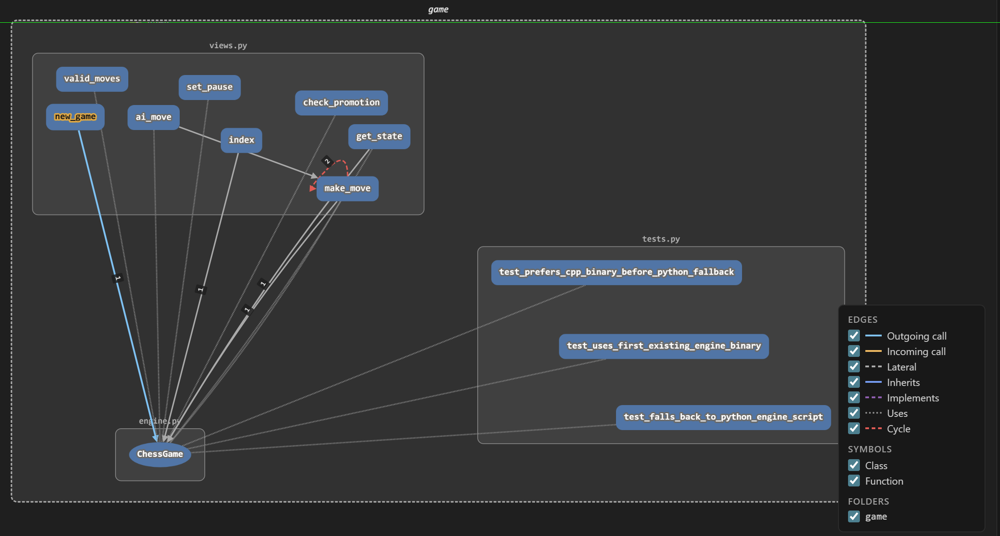

# ♟️ Checkora: Architecture & Engine Structure

> **Welcome to the Checkora Backend!**
> This guide is designed to help new contributors (tracking **Issue #49**) understand the macro-level backend architecture, data flow, and the inner workings of our AI game engine.

---

## 🏗️ High-Level Overview

Checkora is an open-source chess platform built upon the **Django** web framework. Django acts as the central hub, accepting player inputs from the website and sending them into our core AI chess engine to construct the next state. 

**The Hybrid Strategy**  
To guarantee a lightning-fast but crash-proof experience, we utilize a dual-engine architecture:
- 🚀 **Primary Engine (C++)**: Extremely fast at processing millions of calculations to power the engine's AI.
- 🐍 **Fallback Engine (Python)**: An exact structural replica of the C++ engine. If the deployment server ever lacks permissions to run the compiled C++ binary, Checkora securely falls back to Python execution so the game never crashes. The same happens when the binary was built from older sources: it is asked for its protocol version and is not used unless it answers `VERSION 2`.

---

## 🌐 Macro-Level Architecture

The macro-level outlines how our high-level Python application logic orchestrates the game state and initiates isolated engine requests.

### 1. The Controllers (`views.py`)
This file holds the API endpoints that power the frontend interface events:
*   **`make_move`**: Processes a player's physical turn, routing the coordinates to verify mathematical legitimacy.
*   **`new_game`**: Wipes the history logs and instantiates a clean board layout for a fresh PvE or PvP match.
*   **`ai_move`**: Prompts the engine's AI subsystem to compute and execute an optimal calculated response.

The player's own pages live elsewhere: `views_account.py` has the profile, the picture, the settings page and account deletion, and `views_google.py` has "Continue with Google". The rules they use are in `accounts.py`, `avatars.py` and `progression.py`.

### 2. The Translator (`engine.py` & `ChessGame`)
Rather than relying on `views.py` to execute raw chess mechanics, we interact entirely through the `ChessGame` wrapper. 
*   **State Translation**: Converts the complex Python-dictionary chessboard state into a flat, robust text string that the engine can immediately interpret.
*   **Subprocessing Loop**: `ChessGame` hands each text command to `game/engine_client.py`, which finds the engine that runs on this machine and keeps one engine process running per game through `game/engine/persistent_server.py`. That process reads the command on standard input and writes its answer on standard output. If the server cannot be reached, the command goes to a one-off engine process instead.

### 3. The Guardians (`tests.py`)
This suite enforces architectural resilience through rigorous mock and integration tests.
*   **Fallback Enforcement**: Confirms the hybrid execution strategy systematically prioritizes the compiled binary, while explicitly trapping environments requiring the dynamic Python translation.

More test modules cover the engine. `game/test_engine_rules.py` sends rule, protocol and search positions to the engines themselves, to `main.py` always and to the compiled binary when one that runs is present. `game/test_engine_bridge.py` tests the bridge in `engine.py`: the choice of engine, the commands it sends, the difficulty levels and the opening book file. `game/test_persistent_engine.py` tests the per-game server and `engine_client.py`. `game/test_engine_differential.py` plays seeded random games and checks both engines' moves, status and notation against python-chess, and `game/test_engine_evaluation.py` checks evaluation terms such as the king attack. `game/test_levels.py` checks the levels a player can pick and how long each may think.

---

## ⚙️ Micro-Level Engine Logic

This section peers directly into the engine's core (`main.py` & `main.cpp`), detailing execution immediately after the Django wrapper initiates contact.

The function names below are those of `main.py`. `main.cpp` is built the same way with camelCase names (`handleMoves`, `generateMoves`, `makeIfLegal`). A few differ: `handleBestMove` for `search_best_move`, `scoreMoves` for `order_moves`, and the loop is in `main()`.

### **1. The Command Dispatcher (`run`)**
Consider `run()` the processing lobby. When the engine establishes an instance, it binds to standard input in a continuous loop. It reads one command per line and prints exactly one reply line for each, the one `reply()` returns. `reply()` answers `VERSION` on the spot and passes every other command to `handle_command`, which loads the position from the line and calls the handler:
*   **`MOVES`** -> `handle_moves` lists the legal target squares of one piece.
*   **`STATUS`** -> `handle_status` reports check, checkmate, stalemate, a draw by insufficient material, or OK.
*   **`BESTMOVE`** -> `search_best_move` runs the search and prints the move it chose.

A line that cannot be parsed is answered with `ERROR` and a reason. The full command list is in [docs/engine_architecture.md](docs/engine_architecture.md).

### **2. Move Validation Pipeline**
There is one path for deciding whether a move is legal, shared by the commands that need it.
*   `generate_moves` produces the pseudo-legal moves of the side to move: every rule except leaving your own king in check. Castling is only generated when it is fully legal.
*   `make_if_legal` makes a move on the board, asks `attacked` whether the mover's king can now be captured, and takes the move back if so.
*   `generate_legal` keeps the moves that pass, and `find_legal_move` looks up one move among them. `MOVES`, `PROMOTE` and `NOTATION` are all answered from that list. `NOTATION` answers `?` for a move that is not in it.

### **3. The AI Brain (`search`)**
`search_best_move` deepens one ply at a time until the depth or the time it was given runs out, and answers with the best move of the last depth it finished. When time runs out in the middle of a depth that had already found a better move, it plays that move instead, unless alternatives were asked for.
*   **Recursive Calculation**: `search` is a negamax alpha-beta search (principal variation search). It calls itself for every reply until the remaining depth is used up.
*   **Quiet Positions (`quiesce`)**: At the end of a line the search does not stop in the middle of an exchange. It plays out captures and promotions, and every reply to a check, before `evaluate` scores the position.
*   **Move Generation (`generate_moves`)**: Supplies the moves at every node. `order_moves` sorts them so that the likeliest best moves are searched first.
*   **King Safety Check**: A move that leaves the mover's king attacked is taken back and skipped, using `attacked`, so the search never returns an illegal move.

---

## 🔄 End-to-End Execution Flow

Below is the concrete data lifecycle generated when you grab a piece and execute your turn:

| Step | Action Layer | System Response |
| :---: | :--- | :--- |
| **1** | **🖥️ Frontend UI** | The player drags their piece dynamically across the grid. An API `POST` is immediately triggered. |
| **2** | **🔗 Django Views** | Incoming endpoints (`views.py`) trap the grid coordinates, reloading the active JSON session. |
| **3** | **📦 Wrapper Sync** | The `ChessGame` instance translates state layouts entirely to pure terminal commands, initializing the Python or C++ engine IO pipeline. |
| **4** | **🛡️ Engine Logic** | The terminal `run()` loop catches the stream. It answers `MOVES` with the legal targets of the piece, which the wrapper checks the destination against, and after the move `NOTATION` and `STATUS`, each with one line of text. |
| **5** | **✅ Broadcast** | The wrapper processes the safe engine response, updating the server logs and signaling Django responses back to your screen. |
